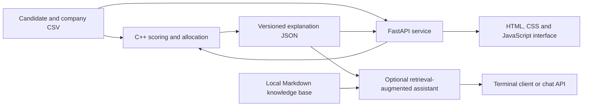

# Stable Allocation Engine (SAE)

Stable Allocation Engine is a student project inspired by SIH25033, “AI-Based
Smart Allocation Engine.” It allocates candidates to internship opportunities
with limited seats and provides explanations for the resulting assignments.

## Overview

The C++17 engine calculates candidate–company fit scores and runs
candidate-proposing deferred acceptance. Candidate preferences can be supplied
in the input CSV; otherwise, companies are ranked by fit score. Company
priority is based on fit score, with candidate ID used to break ties. The
allocator checks seat capacity, assignment consistency, and blocking pairs
under the configured preference rules.

The project also includes a local browser interface and a Python service. The
service invokes the C++ engine and returns its results to the interface. An
optional retrieval-augmented assistant can explain exported results and
provide skill guidance. It does not participate in allocation.

## Architecture



## Matching policy

The default score is a weighted sum on a 0–100 scale:

| Component | Weight |
|---|---:|
| Required-skill overlap | 50% |
| CGPA normalized to 0–10 | 30% |
| Sector match | 10% |
| Location match | 10% |

Weights and optional policy rules are defined in
[`config/allocation_policy_v2.conf`](config/allocation_policy_v2.conf). Required
skills are a soft scoring component in the default policy; missing skills do
not make a candidate ineligible. Qualification, location, sector, and
prior-participation filters are disabled by default. These settings are
prototype assumptions and should not be treated as official PMIS rules.

The allocation is stable only relative to the preference lists, company
priorities, and tie-breaking rules supplied to the engine. It does not
guarantee a maximum total score, fairness, or compliance with all scheme rules.

## Technology

- **Allocation:** C++17 and the standard library
- **API:** Python, FastAPI, Uvicorn, and Pydantic
- **Interface:** HTML, CSS, and vanilla JavaScript
- **Assistant:** Sentence Transformers, NumPy, optional FAISS, and an optional
  Gemini API client
- **Data:** CSV inputs and JSON explanations; no database server is required
- **Build and verification:** Make, `g++`, C++ checks, and pytest

The assistant defaults to a deterministic local mock provider. Gemini can be
configured in `rag_service/.env`; no live Gemini call has been verified. No
machine-learning model is trained for allocation.

## Build and run the C++ application

From the repository root:

```bash
make
./allocator_app
```

The menu loads candidate and company CSV files, builds preference lists, runs
the allocation, displays results, and exports data. Option 7 writes
`exports/candidates.json` and `exports/companies.json` after an allocation.
Press Enter at the CSV prompts to use `data/candidates.csv` and
`data/companies.csv`.

## Run the browser interface

```bash
cd rag_service
python3 -m venv .venv
source .venv/bin/activate
pip install -r requirements.txt
test -f .env || cp .env.example .env
uvicorn app.main:app --host 127.0.0.1 --reload --no-access-log --port 8000
```

Open [http://127.0.0.1:8000](http://127.0.0.1:8000). The interface supports
CSV validation and preview, allocation, result explanations, company
capacity, allocation-trace replay, and synthetic policy scenarios. Browser
allocations use temporary files and do not overwrite the saved exports.

## Input formats

Candidate CSV supports the legacy six-column form and optional extended
fields:

```text
id,name,skills,cgpa,sector,location,preferred_company_ids,qualifications,preferred_locations,sector_interests,prior_participation
```

Company CSV supports the legacy six-column form and an optional qualification
field:

```text
id,name,required_skills,seats,sector,location,required_qualifications
```

List values are semicolon-separated. When `preferred_company_ids` is present,
its order defines the candidate's preferences and acceptable opportunities.
An empty value means the candidate has no acceptable opportunities. If the
column is absent, the engine uses score-ranked preferences. CGPA must be in
the range 0–10, and seat capacity must be positive.

## Tests and reports

```bash
# C++ scoring, allocation, export, and JSON validation
make test

# Python API, assistant, and retrieval checks
cd rag_service && python -m pytest -q

# Seeded synthetic benchmark and policy scenarios
cd ..
make benchmark
make phase3-report
```

## Prototype limits

SAE is a local demonstration project. Its sample data and policy scenarios are
synthetic. It does not implement a complete verified PMIS rulebook, affirmative
action policy, candidate login or consent workflow, or production deployment
security. The optional assistant is advisory and must not be used as an
authoritative source for eligibility or scheme decisions.

## Documentation

- [Complete project handoff](docs/PROJECT_HANDOFF.md)
- [Allocation policy](docs/ALLOCATION_POLICY.md)
- [Data dictionary](docs/DATA_DICTIONARY.md)
- [Requirements traceability](docs/REQUIREMENTS_TRACEABILITY.md)
- [Evaluation and demo guide](docs/PHASE6_EVALUATION_AND_PRESENTATION.md)
- [Python service setup and API](rag_service/README.md)
