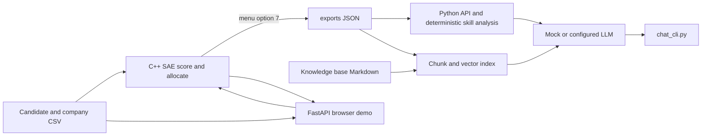

# Stable Allocation Engine (SAE)


A C++ CLI tool that matches candidates to companies with fixed seat counts
using a Gale–Shapley-style stable matching algorithm — built for the PM
Internship Scheme allocation problem (SIH25033/34).

## Problem

Match N candidates to M companies, each with a fixed number of seats, such
that the final assignment is **stable**: no candidate-company pair exists
where both would rather switch away from their current match to be with
each other.

## How It Works

1. **Score** — candidate-company fit is computed from skill overlap, CGPA,
   and sector/location alignment.
2. **Rank** — when an explicit `preferred_company_ids` column is supplied,
   its order is used and is treated as the candidate's acceptable options.
   Legacy six-column files keep score-ranked choices (score descending, then
   company ID ascending).
3. **Allocate** — candidates are processed one at a time from a queue:
   - If their top remaining choice has an open seat, they're placed.
   - If the seat is full, the candidate is compared against the weakest
     holder. Higher score wins; equal scores go to the lower candidate ID.
     A displaced candidate returns to the queue.
4. **Validate** — capacity, one-seat-per-candidate, acceptable assignments,
   and blocking pairs are checked before the result is accepted.

The allocator is stable relative to the explicit/generated preference rankings
and company ranking rules documented in
[docs/ALLOCATION_POLICY.md](docs/ALLOCATION_POLICY.md). It does not promise a
maximum total score or encode official PMIS policy.

## Data Structures Used

| Structure | Where | Purpose |
|---|---|---|
| **Hash Map** (`unordered_map`) | `candidates_`, `companies_`, `scoreCache_` | Average O(1) lookup by ID; caches computed pair scores |
| **Min-Heap** (`priority_queue`, size = seat count) | `Company::heldSeats` | Top of heap = weakest currently-held candidate → O(1) peek, O(log seats) displacement instead of scanning all seat-holders |
| **Queue** (`std::queue`) | `pool` in `Allocator::runAllocation` | Drives the main loop: holds not-yet-placed candidates, re-enqueues anyone displaced |
| **Sorting** (`std::sort`) | `Allocator::buildPreferenceLists` | Run once per candidate to turn raw scores into a ranked preference list |
| **Trace vector** (`std::vector`) | `Allocator::allocationTrace` | Stores proposal, acceptance, rejection, displacement, and unmatched events |

## Project Structure

```
pm_allocation_engine/
├── include/          Header files (candidate.h, company.h, scoring.h, csv_utils.h, allocator.h)
├── src/               Implementation files + main.cpp (CLI menu)
├── data/              candidates.csv, companies.csv (sample/input data)
├── Makefile
└── README.md
```

## Build & Run

```bash
make clean && make
./allocator_app
```

Menu flow (must be done in order):

1. **Load candidates & companies from CSV** — press Enter twice to accept
   the default paths (`data/candidates.csv`, `data/companies.csv`)
2. **Build preference lists** — scores + sorts every candidate
3. **Run stable allocation** — runs the queue/heap matching process
4. **View results** — prints final matches per company + any unmatched candidates
5. **Export results to CSV** — saves to `results.csv`
7. **Export explanation data for RAG assistant** — after allocation, writes
   `exports/candidates.json` and `exports/companies.json`.
8. **Exit**

The engine's original **Exit** entry moved from option 6 to option 8 to leave
the requested explanation-export number at 7; option 6 is currently unused.

## CSV Formats

**`candidates.csv`**
```
id,name,skills(;-separated),cgpa,sector,location
```

An optional seventh candidate column, `preferred_company_ids` (semicolon
separated), supplies the candidate's ranked acceptable companies. If the
column is present but empty, the candidate has no acceptable companies. If it
is absent, the legacy score-ranked behavior is used.

The optional extended header appends `qualifications`, `preferred_locations`,
`sector_interests`, and `prior_participation` after
`preferred_company_ids`. The company CSV can append
`required_qualifications`. These profile fields are for prototype scenarios;
the checked-in policy leaves qualification, location, sector, and
past-participation filters disabled. Prior participation is not included in
per-candidate exports.

```text
id,name,skills,cgpa,sector,location,preferred_company_ids,qualifications,preferred_locations,sector_interests,prior_participation
```

**`companies.csv`**
```
id,name,required_skills(;-separated),seats,sector,location
```

## Scoring

Each candidate-company score (0–100) is a weighted sum of:

- Skill overlap — 50%
- CGPA (normalized out of 10) — 30%
- Sector match — 10%
- Location match — 10%

Weights are configured in `config/allocation_policy_v2.conf` and validated to
sum to 1.0. That file also records the policy version, tie-break, seat rule,
and optional hard requirements. The CLI loads it on CSV import.

These are prototype fit weights. Required skills are currently a soft score
component, not a hard eligibility check. CGPA is validated to 0–10 but no
minimum is imposed. Official scheme constraints have not been inferred.

## Extending

- Change scoring weights or logic in `scoring.cpp`.
- Add a hard skill-requirement filter before building preference lists if
  partial matches shouldn't be considered at all.
- The `Allocator` class is decoupled from CLI I/O, so a future UI (web or
  desktop) can reuse it directly without changes to the core algorithm.

## Browser demo

Phase 4 adds a local browser interface served by the FastAPI service. Start it
using the setup in [rag_service/README.md](rag_service/README.md), then open
`http://127.0.0.1:8000`. The page can validate CSVs, run the C++ allocator,
inspect outcomes and allocation trace, and compare seeded synthetic scenarios.
The web service stores each browser run in a temporary directory; it does not
replace the checked-in or saved export files.

## Status

Phases 0–6 are implemented, including the local browser demo, advisory
assistant, integration scenario, benchmark evidence, and report/presentation
outline. The policy settings and synthetic scenarios remain prototype choices
pending official rule verification. See the
[Phase 6 evaluation and presentation guide](docs/PHASE6_EVALUATION_AND_PRESENTATION.md)
for reproducible results and acceptance evidence, and the
[complete project handoff](docs/PROJECT_HANDOFF.md) for architecture, file
structure, stack, data flow, setup, and implementation history.

Run the reproducible synthetic policy/fairness and sensitivity scenarios with
`make phase3-report`. It prints CSV rows for baseline, score-weight, and
opt-in eligibility-rule variants. The cohort labels are synthetic and are not
protected attributes or evidence of real-world fairness.

## RAG Candidate Assistant

The optional assistant explains the completed allocation and offers skill
guidance. SAE remains the only scoring and allocation engine; the Python
service reads its generated JSON exports and does not modify results.



Run the C++ menu through options **1, 2, 3, and 7** to generate
`exports/candidates.json` and `exports/companies.json`. The menu's Exit action
is option **8**. Then follow the setup and chat instructions in
[rag_service/README.md](rag_service/README.md). The mock provider works without
an API key. Full implementation requirements are in
[docs/SAE_RAG_ASSISTANT_SPEC.md](docs/SAE_RAG_ASSISTANT_SPEC.md), and repository
decisions are recorded in [docs/DECISIONS.md](docs/DECISIONS.md).
