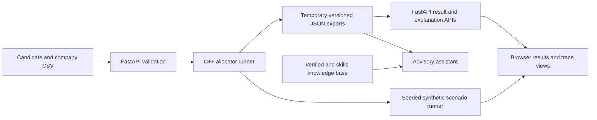

# Phase 6 — Integration, Evaluation, and Presentation

Phase 6 closes the implementation loop with a repeatable integration demo,
measured algorithm comparisons, synthetic policy diagnostics, and a course
report/presentation outline. All allocation examples in this document are
fictional. Benchmark timings are single-run observations, not performance
guarantees.

## End-to-end path



The C++ executable remains responsible for scores, preference lists, and
deferred-acceptance allocation. FastAPI validates input, runs the executable,
loads its explanation export, and serves the browser UI. The optional assistant
reads those results and knowledge-base passages; it has no allocation write
path.

## Reproduce the teaching scenario

The fixtures at `tests/fixtures/phase6/` force the key events: candidate 2 has
higher company priority than candidate 1 and displaces them from company 10;
candidate 1 then takes their next choice, candidate 3 remains unmatched, and
company 30 retains an open seat.

### Command-line allocation

From the repository root:

```bash
make allocator_runner
./allocator_runner \
  tests/fixtures/phase6/candidates.csv \
  tests/fixtures/phase6/companies.csv \
  /tmp/sae-phase6-export \
  config/allocation_policy_v2.conf
```

Inspect `/tmp/sae-phase6-export/candidates.json` for the allocation trace and
`companies.json` for the open seat. Expected summary: 3 candidates, 2 assigned,
1 unmatched, 2 of 3 seats filled. Company 10 holds candidate 2, company 20
holds candidate 1, and company 30 has an unfilled seat.

### Browser walkthrough

Start the local service as described in [the service README](../rag_service/README.md)
and open `http://127.0.0.1:8000`.

1. Upload the two Phase 6 fixture CSV files from `tests/fixtures/phase6/`.
2. Mark the data as synthetic, validate it, and run the allocation.
3. In Results, select `Lower Priority` and inspect their second-choice
   assignment and lost first choice.
4. In Algorithm Lab, use the displacement control to show candidate 2 taking
   company 10's seat and candidate 1 returning to the proposal queue.
5. Show candidate 3 as unmatched and company 30 with `0/1` seats filled.
6. Load the seeded scenario report to compare how policy changes alter
   synthetic allocation rates and assignment counts.

The Phase 6 integration check exercises this same input-to-API-to-frontend
path, including the result state, deterministic explanation endpoint, static
frontend assets, and seeded scenario report. Run it with:

```bash
cd rag_service
python -m pytest -q
```

## Benchmark evidence

The benchmark uses `std::mt19937` with fixed seed 42. It compares dense and
sparse score payload construction, heap-based deferred acceptance, a
linear-scan implementation of the same deferred-acceptance decisions, and a
fixed candidate-ID greedy baseline. The following are actual single-run
outputs from macOS arm64 using Apple Clang 21, C++17, and `-O2`:

| Candidates / companies | Edge probability | Edges | Dense / sparse payload bytes | Heap DA / linear DA time | Heap proposals / linear comparisons | DA / greedy matches | DA / greedy total score |
|---|---:|---:|---:|---:|---:|---:|---:|
| 200 / 20 | 0.05 | 201 | 32,000 / 3,216 | 0.177 / 0.112 ms | 140 / 162 | 113 / 110 | 6,507.08 / 6,156.81 |
| 1,000 / 50 | 0.25 | 12,315 | 400,000 / 197,040 | 3.165 / 1.939 ms | 5,418 / 61,984 | 650 / 650 | 51,792.22 / 45,733.98 |
| 2,000 / 100 | 0.50 | 99,929 | 1,600,000 / 1,598,864 | 20.095 / 13.102 ms | 40,293 / 506,909 | 1,300 / 1,300 | 112,280.58 / 101,226.60 |

Re-run the default with `make benchmark`. For the other rows, first build it
with `make benchmarks/allocator_benchmark`, then run:

```bash
./benchmarks/allocator_benchmark 200 20 0.05 42
./benchmarks/allocator_benchmark 2000 100 0.50 42
```

Across these runs, heap and linear deferred acceptance returned the same
assignments; the heap version performed far fewer holder comparisons at larger
sizes, while the linear version was faster in these measured runs. Dense versus
sparse byte counts are payload estimates, not process memory. Greedy is a
teaching baseline, and its total score is not a fairness or optimality metric.
Timings vary with machine, compiler, load, and run conditions; these were not
averaged over repeated trials.

## Synthetic fairness and sensitivity evidence

Reproduce with `make phase3-report` or load the same fixed-seed output in the
browser. Seed 25033 generates 400 fictional candidates in two artificial
cohorts and 24 companies with 240 seats. In the baseline, the allocation rates
were 63.5% and 56.5% (a 7 percentage-point gap). Skills emphasis changed 53
assignments and produced rates of 61.5% and 58.5%; the qualification what-if
changed 202 assignments and produced the same allocation rates. These outputs
show sensitivity to policy choices in this generator. They do not show which
policy is fair, establish a causal effect, or represent protected groups.

The run filled every seat in all scenarios because the generated workload has
exactly 240 seats and sufficient acceptable demand. Qualification, location,
and prior-participation filters remain disabled in the shipped policy. Their
scenario variants are counterfactual demonstrations only.

## Correctness and regression evidence

On 2026-10-22, from the repository root, `make test` passed the C++ scoring,
allocator, export, and JSON validation checks. In `rag_service`, `python -m
pytest -q` passed 27 tests, including the new full-path scenario. The only
reported warning is Starlette's deprecation notice for its current `httpx`
TestClient integration. No live Gemini request was made. The integration check
uses the deterministic local/mock service behavior and synthetic CSV fixtures.

## Report outline

1. **Problem and scope** — SIH25033 context; what the prototype demonstrates
   and what it does not claim to implement.
2. **Requirements traceability** — connect each project requirement to the
   relevant code, test, UI view, or documented limitation using
   [the traceability matrix](REQUIREMENTS_TRACEABILITY.md) and
   [project decisions](DECISIONS.md).
3. **Architecture and data flow** — show the diagram above and explain the
   C++/Python responsibility boundary and advisory-only assistant.
4. **Data model and policy** — candidate/company records, acceptable edges,
   declared weights, policy switches, deterministic tie-break, and synthetic
   assumptions.
5. **Algorithm and data structures** — deferred-acceptance pseudocode, graph,
   proposal queue, per-company priority queue, trace, and operation counters.
6. **Complexity and evaluation** — state the graph-size variables and report
   measured operation counts separately from machine-dependent times.
7. **Results** — explain the displacement fixture, unmatched/open-seat case,
   algorithm baseline comparison, and scenario sensitivity table.
8. **Privacy, safety, and limitations** — describe local-only demo controls,
   synthetic data, the limited [source-backed scheme FAQ](../kb/scheme_faq.md),
   no candidate login/consent flow, and no live Gemini validation.
9. **Conclusion and next steps** — list evidence required before any
   production or policy claim.

### Deferred-acceptance pseudocode

```text
queue every candidate with at least one acceptable company
while queue is not empty:
    candidate = pop_front(queue)
    company = candidate's next company in preference order
    if company has a free seat:
        company holds candidate
    else if candidate outranks company's weakest held candidate:
        displace the weakest candidate
        company holds the new candidate
        if displaced candidate has another choice:
            push displaced candidate to queue
    else if candidate has another choice:
        push candidate to queue
record final matched or unmatched outcomes
```

Let `n` be candidates, `m` companies, `E` acceptable edges, and `K` the
maximum company capacity. Every acceptable edge receives at most one proposal,
so there are at most `E` proposals. Building the graph takes O(n + m + E)
space and traversal work after preference lists exist. With the current
per-company heaps, seat updates are O(log K) each, giving O(E log K) worst-case
allocation update work, plus list construction and queue operations. Legacy
score-generated rankings require O(nm) score calculations and
O(nm log m) sorting in the worst case. These bounds describe this prototype's
declared preference model, not an external scheme's full allocation rules.

## Presentation outline (8 slides)

1. SIH25033-inspired problem, project objective, and scope boundary.
2. End-to-end architecture and C++/Python separation.
3. Data structures and deferred-acceptance algorithm.
4. Live displacement walkthrough with queue and seat heap.
5. Candidate result explanation, unmatched applicant, and open seat.
6. Benchmark comparison: operation counts, payload, and measured runtime.
7. Synthetic policy sensitivity results and why they are not fairness proof.
8. Limitations, privacy boundary, evidence-backed conclusion, and next steps.

### Three-minute demo script

| Time | Presenter action and point |
|---|---|
| 0:00–0:20 | State that the records are synthetic and explain the goal: make matching decisions inspectable. |
| 0:20–0:45 | Load the two fixture CSVs, validate them, and run the C++ allocator through the local browser. |
| 0:45–1:25 | Open Algorithm Lab and step through candidate 2 displacing candidate 1 from company 10; point out the queue and seat heap. |
| 1:25–1:55 | Show candidate 1 taking company 20, candidate 3 unmatched, and company 30's open seat. Open the candidate explanation to connect the outcome to exported score/cutoff facts. |
| 1:55–2:35 | Load the fixed-seed policy sensitivity report, then summarize the 7-point synthetic baseline allocation-rate difference and its limits. |
| 2:35–3:00 | Show the algorithm benchmark comparison and close with the prototype boundary: synthetic-only evidence, no verified full rulebook, no trained ML model, and no public multi-user deployment. |

The walkthrough was checked against the fixture, API response, and benchmark
outputs. The presenter should still practice aloud and adjust to the course's
time slot; no oral rehearsal is claimed by these repository checks.

## Limitations and acceptance checklist

- [x] Synthetic CSV passes validation, allocation, export loading, result API,
  explanation API, and static frontend checks.
- [x] Demo includes a displacement, a second-choice match, an unmatched
  candidate, and an open seat.
- [x] Fixed-seed algorithm benchmark and policy sensitivity report can be
  reproduced from documented commands.
- [x] C++ regression checks, Python API/service checks, and export validation
  pass; no external LLM call is needed for the integration demo.
- [x] Report and slide outlines include architecture, pseudocode, complexity,
  results, sources/traceability, and limits.
- [ ] Rehearse the talk aloud and time it to the course presentation slot.

The final checklist item is a presenter activity; the written script and
scenario are ready, but elapsed rehearsal time cannot be claimed by an
automated check.
