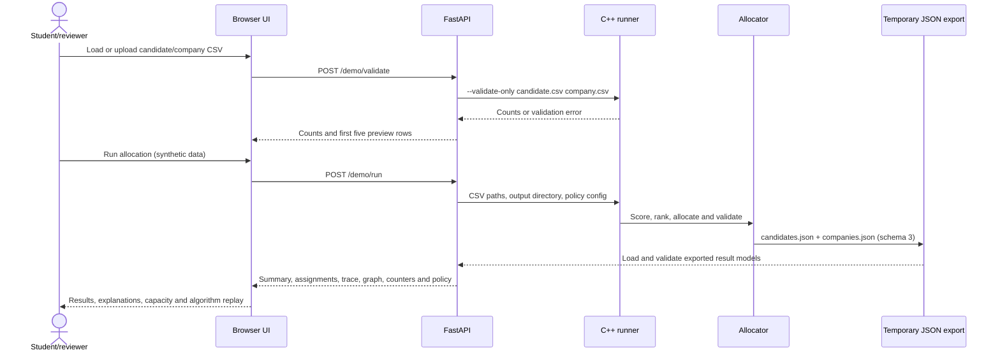

# Stable Allocation Engine (SAE) — Complete Project Handoff

> This guide is intended to let a student, reviewer, or another AI assistant
> understand the project end to end: its problem, architecture, code, data,
> execution, verification, and limits. If this guide and the current source code
> disagree, use the source code and tests as authoritative and update this file.

## 1. Project identity and scope

**Exact project name:** Stable Allocation Engine (SAE)

**Description:** A C++17 candidate-to-internship matching engine with a local
Python API, browser demonstration, data-structure trace, synthetic scenario
analysis, and an optional retrieval-augmented candidate assistant.

**Problem context:** This college prototype is inspired by the SIH 2025 problem
the student identified as **SIH25033 — “AI-Based Smart Allocation Engine”**,
concerning PM Internship Scheme allocation. The repository README also refers
to SIH25033/34. SAE is an independent student prototype, not an official SIH or
PMIS system and not a verified implementation of every government allocation
rule. The dated official source notes used in the project are in
[`kb/scheme_faq.md`](../kb/scheme_faq.md); they cover selected facts, not a full
live rulebook.

### Project-defined problem statement

> Given candidate profiles, candidate opportunity preferences, company role
> requirements, and seat capacities, produce a deterministic and inspectable
> candidate-to-company allocation. Respect the declared preferences and
> capacity limits, explain matched and unmatched outcomes, and let a reviewer
> follow the algorithm's decisions. Provide a local browser demo and an
> advisory assistant that explains already-computed results without changing
> them.

This is the exact problem SAE currently implements. It is not an ML model
predicting placement success and it is not an official PMIS eligibility engine.

### SIH-inspired requirement coverage

The problem context mentions factors such as skills, qualifications, location,
sector interests, prior participation, representation considerations, company
capacity, an AI-based matching engine and a frontend. SAE handles these at
different levels; having a field or simulation does not mean the official rule
has been verified or implemented.

| Factor from the problem context | SAE treatment | Accurate status |
|---|---|---|
| Candidate skills and company requirements | Skill-overlap score component; missing skills are also explained | Implemented as soft fit, not a hard eligibility gate |
| Qualifications | Optional candidate/company CSV fields and exact-label filter | Prototype what-if only; filter disabled by default; no official credential taxonomy |
| Location | Exact location contributes to score; optional preference list/filter supported | Prototype semantics; hard filter disabled by default; remote/hybrid rules unknown |
| Sector interests | Exact sector contributes to score; optional preference list/filter supported | Prototype semantics; hard filter disabled by default |
| Prior participation | Optional boolean input and synthetic exclusion variant | Disabled by default, unknown does not count as prior participation, omitted from candidate exports; no official effect established |
| Affirmative action / representation | Not an allocation input; synthetic A/B report labels only are created in scenario tool | Not implemented; A/B labels are not protected groups and do not satisfy this requirement |
| Company seat capacity | Positive seat count limits held matches | Implemented and validated by the allocator |
| AI-based matching | Deterministic weighted score plus deferred acceptance | Algorithmic matching, not a trained ML model; no outcome prediction |
| Frontend prototype | Local browser UI for CSV, allocation, outcomes, trace and scenarios | Implemented for demonstration; not production service |

## 2. What a user can do

1. Load candidate and company CSV files through the C++ CLI or local browser.
2. Validate the input and receive useful errors when its shape or values are
   invalid.
3. Compute candidate-company fit scores and preference lists.
4. Allocate limited seats with deterministic, candidate-proposing deferred
   acceptance.
5. Inspect assignments, unmatched candidates, open seats, score components,
   preference rank, reason codes, company cutoffs, allocation trace, graph
   statistics, and operation counters.
6. Compare heap and linear implementations of the same deferred-acceptance
   decisions and a simple greedy baseline on seeded synthetic data.
7. Run seeded fictional policy sensitivity scenarios and view aggregate cohort
   diagnostics.
8. Ask an optional RAG assistant for candidate-scoped explanations and skill
   guidance grounded in exported results and local Markdown knowledge.

The browser does not implement matching. It sends CSV to FastAPI; the service
invokes the C++ runner and returns C++ results. The assistant has no write path
to allocation.

## 3. Architecture and data flow

```mermaid
flowchart LR
  CCSV[Candidate CSV] --> UI[Browser UI]
  COCSV[Company CSV] --> UI
  CCSV --> CLI[C++ CLI]
  COCSV --> CLI
  UI --> API[FastAPI local service]
  API --> VALIDATE[CSV validation through C++ runner]
  VALIDATE --> RUN[C++ SAE runner]
  CLI --> SCORE[Score and preference construction]
  RUN --> SCORE
  SCORE --> GRAPH[Bipartite preference graph]
  GRAPH --> DA[Deferred-acceptance allocator]
  DA --> CHECK[Capacity, invariant and blocking-pair checks]
  CHECK --> EXPORT[Versioned JSON explanation export]
  EXPORT --> API
  API --> RESULTS[Dashboard and trace replay]
  KB[Local Markdown knowledge base] --> RETRIEVER[Chunk, embed and retrieve]
  EXPORT --> RETRIEVER
  QUESTION[Candidate question] --> RETRIEVER
  RETRIEVER --> MODEL[Local mock or optional Gemini]
  MODEL --> ANSWER[Answer with source references]
  ANSWER --> CHAT[Terminal chat client or chat API]
  SCENARIOS[Seeded synthetic scenarios] --> UI
```



### Component responsibilities

| Component | Responsibility | Does not do |
|---|---|---|
| C++ allocation engine | Parse CSV, validate core inputs, score pairs, build preference graph, allocate seats, check invariants/stability, export explanations | Call an LLM, infer official government policy, train an ML model, or make decisions in the browser |
| FastAPI service | Serve local UI/API, validate and run C++ for uploaded demo CSVs, load JSON exports, explain outcomes, retrieve knowledge, call selected answer provider | Recompute or alter an allocation, or treat an ID as authentication |
| Browser frontend | Load/edit CSV text, call validation/run APIs, display results/capacity/trace/scenarios | Apply matching or eligibility policy independently |
| Assistant/RAG layer | Retrieve relevant Markdown/company facts and respond to a scoped question | Decide eligibility, alter scores/preferences/matches, or overrule exported facts |
| Benchmark/scenario tools | Generate seeded fictional workloads and report counts/timings/assignment or aggregate sensitivity | Prove real-world fairness, policy compliance, or deployment-scale performance |

### Allocation request sequence



### Assistant request sequence

```mermaid
sequenceDiagram
  actor Person
  participant CLI as chat_cli.py or API caller
  participant API as FastAPI /chat
  participant Guard as Scope and numeric checks
  participant Data as Selected candidate export facts
  participant RAG as Retriever/index
  participant LLM as Mock or optional Gemini
  Person->>CLI: Ask about selected result or skill guidance
  CLI->>API: Candidate ID, session ID and question
  API->>Guard: Validate length, scope and selected candidate
  API->>Data: Select only that candidate's exported facts
  API->>RAG: Retrieve relevant policy/skill/company passages
  API->>LLM: Minimized facts, question, retrieved passages and bounded history
  LLM-->>API: Draft answer
  API->>Guard: Check numeric claims; attach sources and disclaimer
  API-->>CLI: Advisory answer, source labels and disclaimer
  CLI-->>Person: Render response
```

A live Gemini call was not made during implementation and is not necessary to
run the matching demo.

## 4. Matching model and policy

### Input files

Candidate CSV supports six-column legacy input, explicit preferences, and an
extended profile:

```text
id,name,skills,cgpa,sector,location,preferred_company_ids,qualifications,preferred_locations,sector_interests,prior_participation
```

Company CSV supports the legacy six columns or an extended qualification field:

```text
id,name,required_skills,seats,sector,location,required_qualifications
```

Skills and list-valued fields use semicolons. C++ parses numeric IDs and the
JSON exporter represents them as strings. CGPA must be 0–10; seats must be
positive. Quoted commas and escaped quotes are handled on a single CSV line;
multiline quoted cells are not supported.

### Fit score

The default `prototype-score-v2` score is 0–100:

```text
skill_fit     = matched required skills / required skills count
                (1.0 if company has no required skills)
cgpa_fit      = CGPA / 10
sector_fit    = 1 for exact sector match, else 0
location_fit  = 1 for exact location match, else 0

score = 100 * (0.50 * skill_fit
             + 0.30 * cgpa_fit
             + 0.10 * sector_fit
             + 0.10 * location_fit)
```

Weights are configured in [`config/allocation_policy_v2.conf`](../config/allocation_policy_v2.conf),
must be nonnegative, and must sum to 1. Skills are trimmed and compared
case-insensitively. If `sector_interests` or `preferred_locations` are
provided, those lists are used for the matching component; otherwise the
single sector/location field is used.

Required skills contribute to a soft fit score; missing skills do not, by
default, make a candidate ineligible. There is no CGPA minimum. Optional
qualification, location, sector and prior-participation filters are available
for controlled scenarios but disabled in shipped policy because their official
semantics have not been verified.

### Preference and priority rules

- If `preferred_company_ids` is present, it is both the candidate's ordered
  preference list and their acceptable set. An empty explicit list means no
  acceptable opportunities.
- If that column is absent, legacy input ranks all policy-eligible companies by
  fit score descending, then company ID ascending.
- Company priority is score descending, then candidate ID ascending.
- The initial candidate proposal queue uses ascending candidate IDs.
- A company with an open seat accepts a proposal. At capacity, it compares a
  challenger with its weakest current holder. If the challenger ranks higher,
  the holder is displaced and returns to the queue to try the next preference.

### Algorithm and stability

The allocator uses candidate-proposing deferred acceptance (Gale–Shapley-style)
with company capacities. After allocation it validates that each candidate has
at most one seat, company capacity is respected, assigned company pairs are
acceptable, internal state is consistent, and no blocking pair exists under
the declared rankings.

“Stable” is bounded to the input/generated preference lists, score-based
company rankings, and deterministic tie-breaks. It does not imply maximum
total score, maximum utilization for every input, policy fairness, official
PMIS compliance, or likely placement success.

### Data structures and costs

| Structure | Use | Cost/benefit |
|---|---|---|
| `unordered_map` | Candidate/company lookup and score cache | Average O(1) lookup; worst-case linear |
| Bipartite `PreferenceGraph` adjacency vectors | Candidate-to-company acceptable edges and reverse company adjacency | O(n + m + E) graph storage; iterate acceptable proposals |
| `std::queue` | Candidates with another proposal to make | Amortized O(1) push/pop; at most E proposals |
| Per-company min-heap (`priority_queue`) | Current seat holders, weakest priority at top | O(1) weakest peek; O(log k) insert/removal for capacity k |
| Preference vectors plus `std::sort` | Candidate proposal order | O(d log d) for d score-ranked options; explicit order copied directly |
| Trace vector | Ordered proposal/decision/final events | O(T) for T recorded events; used for audit and UI replay |

For `n` candidates, `m` companies, `E` acceptable edges, and max capacity `K`,
graph construction/traversal is O(n + m + E) after preferences exist; seat
updates are O(E log K) worst-case. Legacy ranking scores up to `nm` pairs and
sorts up to `m` companies for each candidate, giving O(nm + nm log m)
worst-case ranking work. These are theoretical bounds, not timing guarantees.

### Explanation export

The C++ exporter writes schema version 3 JSON:

- `candidates.json`: policy and algorithm labels, tie-break description,
  active rules, generated timestamp, graph counts/density, operation counts,
  weights, candidate facts, allocation status/rank/score/reason, top choices,
  score breakdown, matched/missing skills, cutoffs, reason codes and ordered
  allocation trace.
- `companies.json`: company facts, seats and seats filled, role requirements,
  and cutoff when full (null for an open seat).
- Prior-participation status is not exported per candidate.
- The Python Pydantic loader supports the repository's legacy export versions
  and schema 3, and rejects unsupported/malformed exports.

## 5. Implementation history: Phase 0 through Phase 6

| Phase | What changed | Main implementation/evidence |
|---|---|---|
| 0 — Baseline and requirements | Inspected existing C++ CLI, scoring, CSV, JSON export and assistant; mapped gaps, fields, assumptions and policy dependencies | [`PHASE0_BASELINE.md`](PHASE0_BASELINE.md), [`DATA_DICTIONARY.md`](DATA_DICTIONARY.md), [`REQUIREMENTS_TRACEABILITY.md`](REQUIREMENTS_TRACEABILITY.md), Phase 0 draft fixtures |
| 1 — Matching model and correctness | Added explicit acceptable preference lists, deterministic ties, configurable policy/weights, input checks, reasoned outcomes, and allocation invariant/blocking-pair checks | [`ALLOCATION_POLICY.md`](ALLOCATION_POLICY.md), `src/allocator.cpp`, `src/allocation_policy.cpp`, C++ tests |
| 2 — Data Structures lab | Added bipartite preference graph, operation counts and event trace; benchmarked heap/linear deferred acceptance, dense/sparse payload construction and greedy baseline | [`PHASE2_DATA_STRUCTURES.md`](PHASE2_DATA_STRUCTURES.md), `benchmarks/allocator_benchmark.cpp`, schema 3 exports |
| 3 — SIH criteria and fairness simulation | Added optional qualification/location/sector/prior-participation data and disabled-by-default filters; created seeded, fictional policy sensitivity/cohort diagnostics | [`PHASE3_POLICY_AND_FAIRNESS.md`](PHASE3_POLICY_AND_FAIRNESS.md), `tools/phase3_scenarios.cpp`, Phase 3 CSV fixtures |
| 4 — Frontend prototype | Added local static browser workspace for CSV upload/edit/validation, allocation results, candidate/company detail, trace/queue/heap replay and seeded scenario comparison | `frontend/index.html`, `frontend/styles.css`, `frontend/app.js` |
| 5 — Assistant, sources and safeguards | Added dated FAQ source notes, Markdown knowledge retrieval/index, candidate-scoped advisory assistant, mock and optional Gemini clients, local access/privacy controls and real-data opt-in | [`PHASE5_PRIVACY_AND_ACCESS.md`](PHASE5_PRIVACY_AND_ACCESS.md), `rag_service/app/`, `kb/`, mocked/offline tests |
| 6 — Integration, evaluation and presentation | Added a reproducible displacement/unmatched/open-seat fixture, API-to-frontend acceptance check, benchmark evidence matrix, report outline and timed demo script | [`PHASE6_EVALUATION_AND_PRESENTATION.md`](PHASE6_EVALUATION_AND_PRESENTATION.md), `tests/fixtures/phase6/`, roadmap status |

All implementation phases (0–6) are marked complete in the roadmap. The timed
oral presentation is for the student to rehearse; a script is prepared, but an
oral rehearsal is not claimed.

## 6. RAG assistant and exact model status

### Retrieval flow

“RAG” here means the service chunks local Markdown and generated company
descriptions, embeds the chunks, retrieves relevant passages, and supplies
those passages with minimized candidate facts to the answer provider. It does
not train or fine-tune a model.

- Knowledge sources: `kb/how_allocation_works.md`, dated `kb/scheme_faq.md`,
  company descriptions generated from loaded exports, `kb/skills/*.md`, and
  `kb/skill_aliases.json`.
- Markdown chunks are split around headings with defaults of 400 and 50 for
  max/overlap units. The current chunker counts whitespace-separated words
  even though the parameter names say tokens.
- Default embedding model name: `sentence-transformers/all-MiniLM-L6-v2`.
- Vectors are normalized. FAISS `IndexFlatIP` is used if available; NumPy
  similarity search is the fallback. The local index defaults to
  `rag_service/.index/` and is Git-ignored.
- `/admin/reindex` builds or loads the index. The first model download can
  require network access if its weights are not cached.

### Answer provider

- **Default: `LLM_PROVIDER=mock`.** A deterministic local provider is used for
  offline behavior/tests; no API key is needed.
- **Optional: Gemini.** Set `LLM_PROVIDER=gemini`, `GEMINI_API_KEY`, and an
  explicit `LLM_MODEL` in the ignored `rag_service/.env`. The client calls
  Google's Gemini `generateContent` API through HTTPX.
- No concrete Gemini model is pinned in source. It is whatever the operator
  places in `LLM_MODEL`. Tests mock HTTP responses. No live Gemini API call was
  made, and the opt-in smoke script was not run.
- Sentence Transformers is the retrieval embedder, not the answer model and
  not the allocation engine.
- No supervised ML model was trained. The allocator's score is a deterministic
  ranking signal, not a probability.

The API scopes each answer to one selected candidate, omits their name and ID
from the prompt, bounds chat history, attaches retrieved sources and a
disclaimer, and replaces unsupported numeric claims with a fallback. These
guardrails lower risk but cannot guarantee every generated sentence is true.
The assistant cannot change a score, preference list, eligibility result or
assignment.

## 7. Browser frontend and API

### Browser features

- **Input/workspace:** load synthetic sample, select candidate/company CSVs,
  edit CSV text, classify synthetic/demo data, validate and preview data, run
  allocation.
- **Results:** candidate/company counts, assigned/unmatched counts, seats and
  utilization; candidate search and sector/outcome filters; selected
  candidate assignment, score breakdown, ranked choices and reasons; company
  seats/cutoffs.
- **Algorithm Lab:** navigate allocation events, filter key events, jump to a
  displacement, replay the candidate queue and company seat holders.
- **Scenario report:** load a fixed-seed synthetic cohort/policy report and
  compare allocation rates, unmatched counts, score averages, assignment
  changes and seats.

There is no chat widget in the static frontend. The assistant is available via
the terminal client and `POST /chat` API.

### HTTP endpoints

| Method/path | Purpose |
|---|---|
| `GET /` | Serve the browser demo |
| `GET /static/{file}` | Serve JavaScript and CSS |
| `GET /health` | Export/provider readiness and privacy state; no secret key returned |
| `GET /demo/sample` | Read the checked-in sample CSV files |
| `POST /demo/validate` | Validate CSVs with the C++ loader and return counts/previews |
| `POST /demo/run` | Run the C++ allocation and return result/trace state |
| `GET /demo/state` | Return current saved-export or temporary demo state |
| `GET /demo/scenarios` | Run seeded Phase 3 synthetic scenarios |
| `GET /candidates/{id}/summary` | Deterministic explanation from exports |
| `GET /candidates/{id}/skill-gap` | Deterministic ranked missing-skill suggestions |
| `POST /chat` | Candidate-scoped advisory assistant endpoint |
| `POST /admin/reload` | Reload exports; protected by admin token |
| `POST /admin/reindex` | Build/load retrieval index; protected by admin token |

The two demo POST routes accept `candidates_csv` and `companies_csv` as CSV
text. `/demo/run` also accepts `dataset_name` and a boolean `synthetic` flag;
the flag must be true for demo records unless the operator deliberately enables
`SAE_ALLOW_REAL_DATA=1`. `/chat` accepts `candidate_id`, optional `session_id`,
`message`, and optional `debug`. Admin routes require `X-Admin-Token`.

## 8. Privacy and operational boundary

- Direct connections must be loopback; CORS is limited to local origins. Do
  not put the app behind a public/shared reverse proxy because remote peers
  could appear to be loopback.
- Request bodies over 2,100,000 bytes are rejected, including chunked bodies.
- Per-process in-memory limits: chat 20/min, CSV validate/run 12/min, admin
  operations 5/min, other routes 120/min. These are local demo protections,
  not production distributed rate limiting.
- Admin endpoints stay disabled unless `SAE_ADMIN_TOKEN` has at least 32
  characters and is sent with `X-Admin-Token`; comparison is constant time.
- Non-synthetic browser allocation is off unless `SAE_ALLOW_REAL_DATA=1` is
  explicitly set by an authorized local operator.
- Browser uploads/exports live in a temporary directory while that demo is
  active. They are cleaned on a later run, reload or process shutdown and do
  not overwrite saved repository exports.
- Chat state is in process memory, capped at 1,000 candidate/session pairs,
  and bounded by `MAX_HISTORY_TURNS` (default 2); it clears on reload/new run.
- Gemini mode sends minimized result/skill facts, the question and retained
  turns to Google. Review `/health` privacy notice and obtain authorization
  before using real records with Gemini.
- `rag_service/.env` may contain secrets and is ignored. Never paste secret
  values into this guide, a report or shared LLM context.
- There is no candidate login, consent workflow, durable chat history, public
  multi-user security model or production deployment design.

## 9. Technology stack

| Layer | Technology | Purpose |
|---|---|---|
| Allocation engine | C++17 and standard library | Scoring, preference graph, matching, trace and JSON export |
| Build | Make and `g++`/Apple Clang-compatible driver | CLI, runner, tests, benchmark and scenario binaries |
| Data interchange | CSV and JSON | Inputs and versioned explanations |
| API | Python, FastAPI, Uvicorn, Pydantic | Routes, validation, typed exports and frontend hosting |
| Retrieval | Sentence Transformers, NumPy, optional FAISS CPU | Markdown embeddings and nearest-neighbor search |
| Provider HTTP | HTTPX and optional Google Gemini `generateContent` | Mocked/local default or external answer generation |
| Frontend | Vanilla HTML, CSS and JavaScript | Browser workflow, result dashboard and trace/scenario views |
| Verification | C++ assertion executables, pytest, mocked HTTP | Matching/export, API/RAG/provider/integration checks |
| Persistence | Local files and temporary directories | No database server; temporary web allocations and local vector index |

Python package versions are pinned in
[`rag_service/requirements.txt`](../rag_service/requirements.txt). Phase 6 was
checked on Python 3.13.3 and Apple Clang 21 on macOS arm64. Python 3.10+ is
recommended for the syntax used by this service.

## 10. Repository file structure

```text
Stable_Allocation_Engine/
├── README.md                         Overview, quick start and links
├── Makefile                          Build, C++ tests, benchmark and scenario targets
├── .gitignore                        Excludes secrets, caches and generated artifacts
├── config/
│   └── allocation_policy_v2.conf     Default weights and disabled prototype rules
├── data/
│   ├── candidates.csv                Sample candidate data; treat as synthetic demo data
│   └── companies.csv                 Sample company/opportunity data
├── include/                          C++ public data models and interfaces
│   ├── allocation_policy.h           Policy types and loader declaration
│   ├── allocator.h                   Allocator, graph, metrics and trace declarations
│   ├── candidate.h                   Candidate profile and proposal state
│   ├── company.h                     Company profile and held-seat heap
│   ├── csv_utils.h                   CSV reader/validator interfaces
│   ├── explain_export.h              Explanation JSON exporter interface
│   └── scoring.h                     Weights, breakdown and scoring declarations
├── src/                              C++ implementation
│   ├── allocation_policy.cpp         Parse/validate config and rules
│   ├── allocator.cpp                 Preferences, graph, allocation, checks, trace
│   ├── csv_utils.cpp                 CSV parsing and validation
│   ├── explain_export.cpp            Schema 3 explanation JSON files
│   ├── main.cpp                      Interactive C++ menu CLI
│   ├── runner.cpp                    Noninteractive runner used by API and demo
│   └── scoring.cpp                   Fit score and components
├── benchmarks/
│   └── allocator_benchmark.cpp       Seeded heap/linear/greedy and dense/sparse comparison
├── tools/
│   └── phase3_scenarios.cpp          Seeded policy/fairness sensitivity CSV output
├── frontend/
│   ├── index.html                    Browser layout, forms, tabs and accessibility labels
│   ├── app.js                        API calls, rendering, trace replay and scenarios
│   └── styles.css                    Responsive visual styling
├── exports/
│   ├── .gitkeep                      Keeps the export directory in source control
│   ├── candidates.json               Generated/ignored candidate result export
│   └── companies.json                Generated/ignored company result export
├── kb/
│   ├── how_allocation_works.md       Human-readable engine explanation
│   ├── scheme_faq.md                 Dated official-source notes and links
│   ├── skill_aliases.json            Skill-name normalization aliases
│   └── skills/
│       ├── accounting.md, analytics.md, auditing.md, aws.md
│       ├── branding.md, cloud.md, communication.md, employee-relations.md
│       ├── excel.md, figma.md, finance.md, financial-modeling.md
│       ├── git.md, illustrator.md, inventory-management.md, labor-law.md
│       ├── linux.md, logistics.md, machine-learning.md, marketing.md
│       ├── payroll.md, photoshop.md, prototyping.md, react.md
│       ├── recruitment.md, seo.md, sketch.md, social-media.md
│       ├── sql.md, statistics.md, supply-chain.md
│       └── (one Markdown learning guide per listed skill)
├── rag_service/
│   ├── .env.example                  Safe config template, no secret values
│   ├── README.md                     Service, setup, API and chat instructions
│   ├── requirements.txt              Pinned Python dependencies
│   ├── chat_cli.py                   Terminal assistant client
│   ├── smoke_gemini.py               Opt-in fixed-prompt live provider check
│   ├── app/
│   │   ├── __init__.py               Python package marker
│   │   ├── config.py                 Environment-backed settings
│   │   ├── guardrails.py             Input/scope and unsupported-number checks
│   │   ├── kb_index.py               Markdown chunking, embeddings and local index
│   │   ├── llm.py                    Deterministic mock and optional Gemini clients
│   │   ├── loaders.py                Pydantic export models and schema validation
│   │   ├── main.py                   FastAPI app, middleware and routes
│   │   ├── prompts.py                Candidate-scoped prompt construction
│   │   ├── retriever.py              Search ranking and source labels
│   │   └── skills.py                 Deterministic outcome and skill-gap logic
│   └── tests/
│       ├── conftest.py               Temporary JSON fixtures
│       ├── test_llm.py               Mock/Gemini HTTP behavior
│       ├── test_retrieval.py         Chunking/index/retrieval behavior
│       └── test_service.py           API, privacy, guardrail and end-to-end checks
├── tests/
│   ├── scoring_test.cpp              Score components and normalization
│   ├── allocator_test.cpp            Allocation, policy, tie and invariant cases
│   ├── explain_export_test.cpp       JSON export and cutoff behavior
│   ├── validate_export.py            Export schema/content validation
│   └── fixtures/
│       ├── phase0/                   Historical schema draft examples
│       ├── phase3/                   Extended policy input cases
│       └── phase6/                   Displacement/unmatched/open-seat demo CSVs
└── docs/                              Design, decisions, evidence and handoff
    ├── ALLOCATION_POLICY.md           Current matching semantics and boundaries
    ├── DATA_DICTIONARY.md             Fields, meanings and status
    ├── DECISIONS.md                   Decisions recorded by project stage
    ├── DEMO_NOTES.md                  Assistant/API demo scenarios
    ├── PHASE0_BASELINE.md             Historical pre-improvement snapshot
    ├── PHASE2_DATA_STRUCTURES.md      Invariants, costs and benchmark
    ├── PHASE3_POLICY_AND_FAIRNESS.md  Synthetic sensitivity scenarios
    ├── PHASE5_PRIVACY_AND_ACCESS.md   Privacy, local access and safeguards
    ├── PHASE6_EVALUATION_AND_PRESENTATION.md Final demo/report/benchmark guide
    ├── REQUIREMENTS_TRACEABILITY.md  Requirement-to-code/evidence map
    ├── SAE_RAG_ASSISTANT_SPEC.md     Assistant and export implementation spec
    ├── SIH25033_IMPROVEMENT_ROADMAP.md Phases 0–6 and completion status
    └── PROJECT_HANDOFF.md            This shareable end-to-end guide
```

`rag_service/.env` is intentionally not listed: it is a local ignored file that
may contain an API key. `rag_service/.index/`, Python caches, object files and
compiled executables are generated artifacts, not source documents.

## 11. Build, run and reproduce

### Interactive C++ application

From the repository root:

```bash
make
./allocator_app
```

Menu order: load CSVs (1), build preference lists (2), run allocation (3),
view results (4), optionally export result CSV (5), export explanation JSON
(7), exit (8). Option 6 is unused. Default CSV paths are
`data/candidates.csv` and `data/companies.csv`.

### Local browser demo

```bash
cd rag_service
python -m venv .venv
source .venv/bin/activate
pip install -r requirements.txt
# Only if rag_service/.env does not already exist:
cp .env.example .env
uvicorn app.main:app --host 127.0.0.1 --reload --no-access-log --port 8000
```

Open `http://127.0.0.1:8000`. First browser allocation builds the C++ runner
with Make. The page loads a synthetic sample by default. For the Phase 6 demo,
choose both CSVs in `tests/fixtures/phase6/`, keep the “synthetic/demo records
only” checkbox checked, validate, and run.

### Terminal chat

After exports are available and the service/index has been configured:

```bash
cd rag_service
python chat_cli.py --candidate 1
```

`/summary`, `/gap`, and `/quit` are CLI commands. Mock mode is local. Gemini
requires operator configuration and the CLI's first-call privacy confirmation.

### Tests and analysis

```bash
# C++ score, allocator, export and JSON checks
make test

# Python API, retrieval, mocked provider and integration checks
cd rag_service
python -m pytest -q
cd ..

# Benchmark: 1,000 candidates, 50 companies, seed 42
make benchmark

# Seeded synthetic policy sensitivity report
make phase3-report
```

Phase 6 recorded C++ checks passing and 27 Python tests passing on
2026-10-22. The Python run reported a Starlette/httpx TestClient deprecation
warning. Measurements and sensitivity outputs are in
[`PHASE6_EVALUATION_AND_PRESENTATION.md`](PHASE6_EVALUATION_AND_PRESENTATION.md).

### Small CLI integration demo

```bash
make allocator_runner
./allocator_runner \
  tests/fixtures/phase6/candidates.csv \
  tests/fixtures/phase6/companies.csv \
  /tmp/sae-phase6-export \
  config/allocation_policy_v2.conf
```

Expected: 3 candidates, 2 assigned, 1 unmatched, 2/3 seats filled, one
displacement; candidate 2 holds company 10, candidate 1 holds company 20, and
company 30 has an open seat.

## 12. Configuration reference

Settings are loaded from environment variables; see
[`rag_service/.env.example`](../rag_service/.env.example). Do not put real
secrets in documentation.

| Variable | Example/default | Meaning |
|---|---|---|
| `SAE_EXPORT_DIR` | `../exports` in example | Existing C++ export directory; absent override defaults to repo exports |
| `KB_DIR` | `../kb` | Markdown knowledge base directory |
| `INDEX_DIR` | `./.index` | Local retrieval index directory |
| `EMBED_MODEL` | `sentence-transformers/all-MiniLM-L6-v2` | Embedding model name |
| `LLM_PROVIDER` | `mock` | `mock` or `gemini` answer provider |
| `LLM_MODEL` | empty | Explicit Gemini model name when Gemini is enabled |
| `GEMINI_API_KEY` | empty | External provider secret; store only in ignored `.env` |
| `TOP_K_CHUNKS` | `4` | Maximum retrieved passages |
| `MAX_HISTORY_TURNS` | `2` | Recent turns retained in memory/prompt |
| `MIN_SIMILARITY` | `0.25` | Retriever relevance floor |
| `SAE_ADMIN_TOKEN` | empty | 32+ character token to enable admin endpoints |
| `SAE_LIVE_GEMINI` | `0` | Must be explicitly enabled for fixed-prompt smoke script |
| `SAE_ALLOW_REAL_DATA` | `0` | Must be enabled for authorized non-synthetic local browser runs |

## 13. Verification and limitations

### Evidence in the repository

- C++ tests cover score components/normalization, assignments and tie-breaks,
  displacement, empty preferences, policy switches, CSV validation,
  capacity/stability checks, trace events, exports and open-seat cutoffs.
- Python tests cover export schemas, skill analysis, retrieval/chunking,
  prompts, guardrails, candidate scoping, mocked LLM HTTP behavior, admin
  authorization, loopback restrictions, rate/body limits and the Phase 6
  CSV-to-run-to-result/frontend API scenario.
- Benchmark runs compare heap and linear deferred acceptance (same assignments
  in recorded runs) plus a fixed candidate-ID greedy baseline. Runtime numbers
  are single observations, not averages or deployment benchmarks.
- Synthetic cohorts are generated outside candidate records using candidate
  ID parity. They are not protected groups or evidence of real-world fairness.

### Not implemented or not established

- No trained ML model or authorized historical outcome dataset. The score is
  not a placement probability.
- No complete official SIH/PMIS policy engine, live portal integration, current
  round synchronization, or evidence that the prototype weights equal official
  rules.
- No affirmative-action or protected-group rules. Synthetic cohort rates do
  not establish fairness.
- Qualification taxonomy, hard thresholds, location semantics, sector
  eligibility and past-participation effects remain unverified. Related
  optional rules are disabled by default.
- No database, user login, candidate consent workflow, persistent chat
  history, public multi-user security architecture or production deployment.
- No live Gemini response was checked; no claim that Gemini is free or always
  available; Gemini never decides or changes allocations.
- No maximum-weight/optimal assignment solver. Greedy and data-structure
  comparisons are teaching baselines, not policy recommendations.
- No oral course presentation rehearsal has occurred; a timed script is
  available in the Phase 6 guide.

## 14. Source-of-truth references

- Allocation semantics: [`ALLOCATION_POLICY.md`](ALLOCATION_POLICY.md)
- Input fields: [`DATA_DICTIONARY.md`](DATA_DICTIONARY.md)
- SIH requirements and boundaries: [`REQUIREMENTS_TRACEABILITY.md`](REQUIREMENTS_TRACEABILITY.md)
- Phase history: [`SIH25033_IMPROVEMENT_ROADMAP.md`](SIH25033_IMPROVEMENT_ROADMAP.md)
- Data structures and benchmark: [`PHASE2_DATA_STRUCTURES.md`](PHASE2_DATA_STRUCTURES.md)
- Synthetic sensitivity: [`PHASE3_POLICY_AND_FAIRNESS.md`](PHASE3_POLICY_AND_FAIRNESS.md)
- Privacy/access: [`PHASE5_PRIVACY_AND_ACCESS.md`](PHASE5_PRIVACY_AND_ACCESS.md)
- Final demo and report materials: [`PHASE6_EVALUATION_AND_PRESENTATION.md`](PHASE6_EVALUATION_AND_PRESENTATION.md)
- RAG assistant spec: [`SAE_RAG_ASSISTANT_SPEC.md`](SAE_RAG_ASSISTANT_SPEC.md)
- Implementation decisions: [`DECISIONS.md`](DECISIONS.md)

## 15. Compact briefing for another person or LLM

> Stable Allocation Engine (SAE) is a C++17 and Python/FastAPI student
> prototype inspired by SIH25033's AI-Based Smart Allocation Engine problem.
> The C++ core computes a transparent weighted fit score, builds candidate
> preference lists and company priorities, then runs candidate-proposing
> deferred acceptance with capacity heaps, deterministic ID tie-breaks,
> invariant/stability checks, an event trace, operation counters, and
> schema-versioned JSON explanations. A local vanilla HTML/CSS/JS app calls a
> FastAPI service that runs the C++ core and displays results, capacity,
> trace replay, and seeded synthetic policy scenarios. A separate optional RAG
> assistant retrieves local Markdown and company facts to explain one selected
> candidate's result or skill gaps. The default answer provider is a local
> deterministic mock; Gemini is optional/configured by environment, but no
> live API call has been verified. No ML model is trained. Official policy
> coverage is partial, fairness output is synthetic, and the prototype is not
> designed for public multi-user or production use.

Do not shorten this to “AI decides who gets an internship.” Allocation is
deterministic C++ matching; the LLM is advisory and cannot change it.
